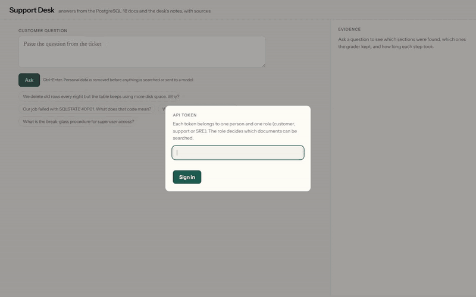
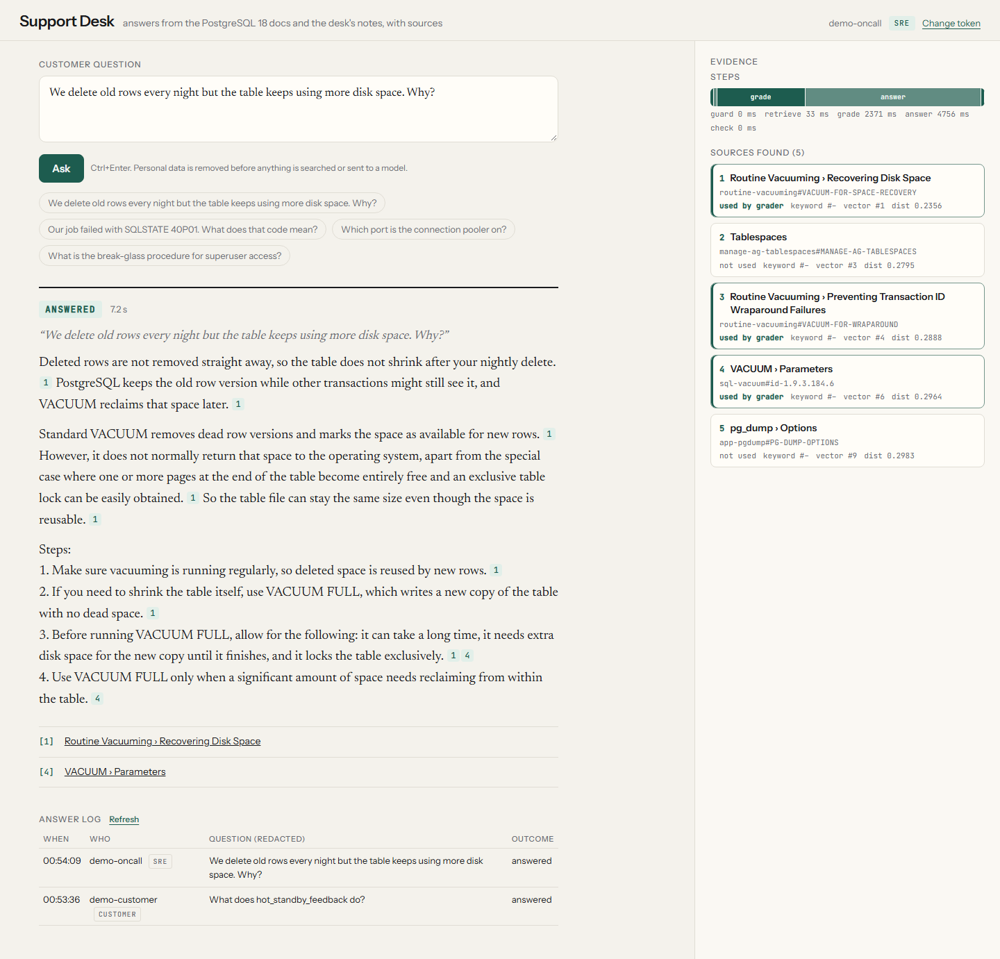
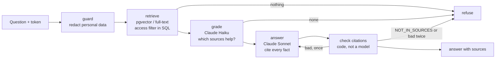

# support-knowledge-assistant

[](https://github.com/Idris-Michael/support-knowledge-assistant/actions/workflows/ci.yml)

A support assistant that answers from the PostgreSQL 18 manual and a support desk's internal notes.
Every sentence is cited to the section it came from, it says so when the documents do not cover a
question, and nobody can receive a note above their access level. Built with LangGraph and
LangChain on Postgres (pgvector and full-text search), Claude for grading and writing, and local
embeddings.



<sub>A live run in real time (54 s): the API, Postgres and the indexer in Docker, Claude answering through the host proxy.</sub>

> Framed as a pilot for a **fictional** UK managed-Postgres host, Larkspur Data
> ([brief](docs/engagement/brief.md)). The documentation is the real PostgreSQL manual; the internal
> notes are written for the project. The code, tests and measurements are real.

## Results

64 questions written in ticket language and committed before any retrieval code existed
([`bench/questions.jsonl`](bench/questions.jsonl)): 50 answerable, 8 with no answer in the
documents, 6 asking for notes above the asker's level. Raw figures in
[`bench/results.json`](bench/results.json).

| | Result | Evidence |
|---|---|---|
| Retrieval, 50 answerable questions (right section in the top 5) | Vector **46**, hybrid 44, keyword 41 | Measured locally |
| Access control: every question as every role, every mode | **576 searches, 0 restricted results** | Measured locally |
| Answerable questions, end to end | **46 answered**, 43 citing a labelled section; 4 refused, 0 errors | Measured locally |
| Questions with no answer in the documents | **8 of 8 refused** | Measured locally |
| Questions asking for restricted notes | 5 of 6 refused; the sixth answered from the public docs instead, with nothing restricted in it | Measured locally |
| Restricted facts in any answer | **0** in 64 answers | Measured locally |
| Answer accuracy | 0 wrong statements in 47 answers; 7 correct but incomplete, each saying what it could not cover | [Hand-checked](bench/hand_check.md) |
| Time per question | Median 8.4 s, p90 10.9 s (two Claude calls) | Measured locally |
| Azure AI Search and Bedrock Knowledge Bases retrievers | Request shapes, access filters and parsing | Tested with mocks |
| Azure and AWS deployment | Terraform validated; tflint and checkov clean | Validated offline, not deployed |

**Hybrid search did not win.** The design this ports used hybrid retrieval, and the manual is full of
exact names, so I expected hybrid to be best. On this set vector search was ahead (46 vs 44); the
keyword side adds loosely matching candidates on long, conversational questions. Vector is the
default and all three modes stay available ([ADR 2](docs/adr/0002-retrieval-mode-chosen-by-measurement.md)).
Nothing was tuned on the test questions.



## How it works



- **Access control is part of the query.** Each section carries an access list; a token's role
  (customer, support, SRE) decides which lists it may read, and the SQL that selects candidates
  filters on it. Restricted text is never retrieved, sent to a model or logged for that user
  ([ADR 3](docs/adr/0003-access-control-in-the-query.md)).
- **A grader before the writer.** A small model picks the sources that actually help; if none do, the
  assistant refuses without asking the larger model. The writer sees only the kept sources
  ([ADR 1](docs/adr/0001-langgraph-flow-with-checked-citations.md)).
- **Citations are checked by code.** At least one, and every one must point at a kept source;
  otherwise one retry, then a refusal. Every refusal uses the same wording, so it does not reveal
  whether restricted notes exist.
- **Personal data never leaves the guard.** Emails, phone, card and NI numbers are replaced before
  retrieval, the models and the answer log, and in internal notes at ingest
  ([ADR 4](docs/adr/0004-pattern-based-redaction.md)).
- **Citations land on the parameter.** Configuration parameters and command options are sections of
  their own, so `[1]` opens `max_wal_size`, not a 40-parameter page.

## What broke while building it

- **Every database call took two minutes.** On Windows, `localhost` tries IPv6 first; Docker had
  bound Postgres to IPv4 only, and the IPv6 attempt hung rather than failing. Connecting took 130 s;
  with `127.0.0.1` it takes 0.04 s, and a search 0.12 s. The engine now also has a 5-second connect timeout.
- **An NI number went into the index unredacted.** The pattern followed HMRC's rules for which letters
  an NI number may start with, and so missed `QQ 12 34 56 C`, HMRC's own example, in a test note. A
  test caught it; redaction now over-matches.
- **"Found" is not "answerable".** Retrieval counted the error-codes table as found for "what is
  SQLSTATE 40P01?", but that table is split into many chunks and the one kept was not the one with
  40P01. The assistant refused rather than guess, which is right, but the retrieval score hid the
  miss ([hand check](bench/hand_check.md)).
- **The tests read my `.env`.** Two tests passed in CI-like conditions and failed on my machine once
  `.env` held real tokens. Tests now ignore `.env` entirely.

## Run it

```bash
cp .env.example .env              # API_TOKENS (one per person) and LLM_MODE
ollama pull nomic-embed-text      # local embeddings
docker compose up -d --build      # Postgres + pgvector, migrations, index, API; Jaeger on :16686
open http://localhost:8080        # Support Desk console
```

`LLM_MODE=offline` needs no model at all (keyword rules, for trying the flow); `LLM_MODE=proxy`
uses Claude through `uv run ska-llm-proxy` on the host. From the command line:

```bash
uv sync
uv run ska ask "Is max_wal_size a hard limit?" --role customer
uv run ska search "too many clients already" --mode hybrid --role support
uv run pytest                     # 97 tests, 80% coverage gate; Postgres tests need Docker
uv run python bench/retrieval.py  # retrieval modes + leak check, ~30 s, no model calls
```

Everything else is in the [runbook](docs/engagement/runbook.md).

## Repository map

```
src/support_knowledge_assistant/
  agent.py      the LangGraph flow          retrieve.py   pgvector / full-text / RRF, access filter
  llm.py        Claude CLI, proxy, offline  adapters.py   Azure AI Search, Bedrock Knowledge Bases
  corpus.py     docs → citable sections     redact.py     personal data
  indexer.py    chunk, embed, store         api.py        HTTP API; static/console.html
corpus/         page list, manifest, sections.jsonl, internal/ (fictional notes)
bench/          questions.jsonl (fixed first), results.json, answers.json, hand_check.md
infra/          Terraform: Azure Container Apps, AWS ECS Fargate
docs/           engagement brief, security questionnaire (incl. OWASP LLM Top 10), runbook, handover, ADRs
```

## Evidence labels
**Measured locally**: run on a Windows laptop on 24 November 2026, Claude Haiku 5.5 grading and
Claude Sonnet 5.5 writing through `claude -p`, nomic-embed-text through Ollama.
**Hand-checked**: every answer read against its cited sections by Claude (the same model family as
the writer, so not independent). A random ten are set aside for a person's review
([spot check](bench/spot_check.md), pending). **Tested with mocks**: mocked HTTP and botocore stubs, never a
live service. **Validated offline**: Terraform checked, never applied.

## Licence
MIT. `corpus/sections.jsonl` contains text from the PostgreSQL documentation under the PostgreSQL
Licence ([`corpus/NOTICE`](corpus/NOTICE)).
